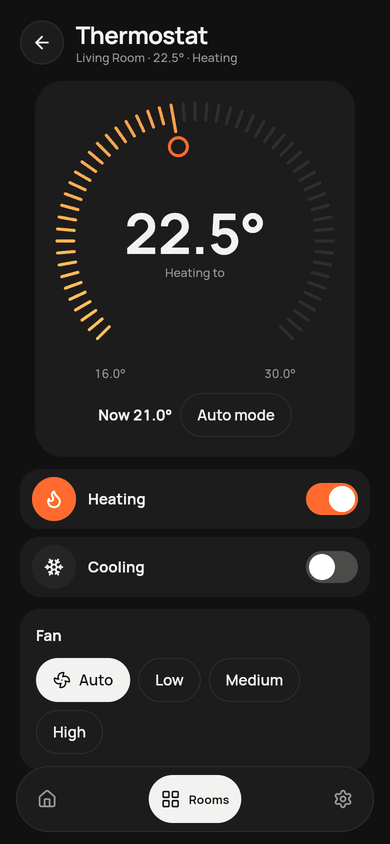
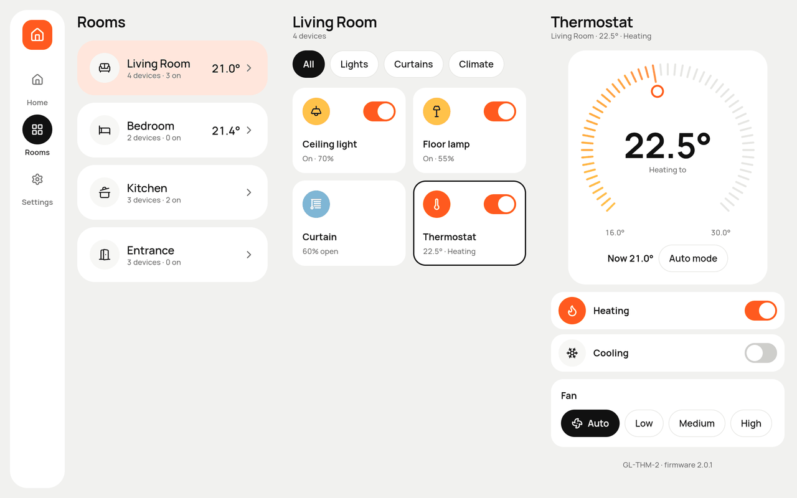

# Glowhaus

An open-source smart home demo app built with Flutter. It shows real-time
device control with optimistic UI, a capability-based device model, a
documented MQTT protocol, adaptive phone / tablet layouts, light and dark
themes with a swappable accent, and English, Persian (RTL) and Turkish.

> Status: milestone 1 (foundation) is done. See the [roadmap](docs/roadmap.md).

**Live demo:** [dannymohajer.github.io/glowhaus](https://dannymohajer.github.io/glowhaus/)
· component catalog: [Widgetbook](https://dannymohajer.github.io/glowhaus/widgetbook/).
Every device is simulated in the browser, so tap anything; Settings →
Simulation adds network delay and failures to show optimistic updates and
rollback.

**See the protocol:** [open with the devices panel](https://dannymohajer.github.io/glowhaus/#/demo).
The panel is the other end of the conversation: twelve virtual devices with
their own buttons and plugs, and the MQTT messages they send and receive.
Its arrow button moves the devices into a second browser tab, where they
keep talking MQTT to the app over a `BroadcastChannel`; close that tab and
they come home.

## Screenshots

| Dashboard | Dark | Persian (RTL) | Thermostat |
|---|---|---|---|
|  |  |  |  |

Wide windows show rooms, room and device side by side:




## Features

- Rooms, devices and a dashboard for a seeded demo home
- Lights (on/off, dimmer, RGB), multi-channel switches, curtains, thermostat,
  outlets with live power, door lock, sensors
- Optimistic control with pending state and rollback on failure or timeout
- Simulated transport with adjustable latency and failure rate
- A devices panel next to the app (`#/demo`): physical buttons, plugs and
  live MQTT traffic, and a two-tab mode over `BroadcastChannel`
- Connection settings: the demo, or a real MQTT broker over TLS / WSS
- Phone and tablet / desktop layouts from one set of routes
- Light / dark / system theme, runtime accent colour, reduced motion
- English, Persian (RTL), Turkish with live switching
- Design system package with a Widgetbook catalog

Coming:

- Scenes UI (milestone 2)
- Real MQTT transport, docker-compose broker and device simulator (milestone 3)
- Scenarios, automations, timers (milestone 4)
- Multiple homes, users and roles, add-device wizard (milestone 5)
- Offline / local control (milestone 6)
- Cameras: ONVIF, RTSP live view, PTZ (milestone 7)

## Repository layout

```
apps/glowhaus/            Flutter app (web, android, macos, ios)
packages/
  glowhaus_domain/        pure Dart: models, capabilities, protocol
  glowhaus_mqtt/          MqttConnection, mqtt_client adapter, in-memory broker
  glowhaus_device/        device engine: the protocol's device side, demo home
  glowhaus_transport/     Transport interface, MqttTransport, SimulatedTransport
  glowhaus_ui/            design system: tokens, themes, components
widgetbook/               Widgetbook catalog of the design system
simulator/                device simulator CLI: the demo home on a real broker
infra/                    docker-compose: Mosquitto (TLS, WSS, per-identity ACLs),
                          simulator image, MediaMTX test camera
docs/                     architecture, protocol, roadmap
```

## Running

Requires Flutter 3.47 or newer.

```bash
dart pub get
```

```bash
cd apps/glowhaus && flutter run -d chrome
```

Workspace scripts (analyze, test, codegen) run through melos:

```bash
dart run melos run analyze
```

```bash
dart run melos run test
```

Web build (app + Widgetbook in `build/site`, with a size report):

```bash
tool/build_web.sh
```

Screenshots of a served build (headless Chrome, into `build/screenshots`):

```bash
python3 -m http.server 8100 --directory build/site
```

```bash
node tool/screenshots.mjs
```

### Embedding

The web build is made to be embedded, for example in a portfolio page:

```html
<iframe src="https://dannymohajer.github.io/glowhaus/" title="Glowhaus demo"
        style="width: 390px; height: 844px; border: 0; border-radius: 28px"
        loading="lazy"></iframe>
```

It uses hash URLs, so reloads inside the frame never 404, and it loads
nothing from third-party hosts.

## CI

`.github/workflows/ci.yml`: format, analyze (zero infos), a check that
regenerating code and translations changes nothing, all tests with goldens on
macOS, the web build with its size table in the job summary, and a GitHub
Pages deploy from `main`.

## Architecture

UI → bloc → repository → `Transport`. The UI never knows whether a device is
simulated, behind an MQTT broker, or on the local network. Details and
diagrams: [docs/architecture.md](docs/architecture.md).

## Protocol

Glowhaus defines its own small MQTT protocol, specified so that anyone can
build a compatible device: [docs/protocol.md](docs/protocol.md).

## License

[MIT](LICENSE)
