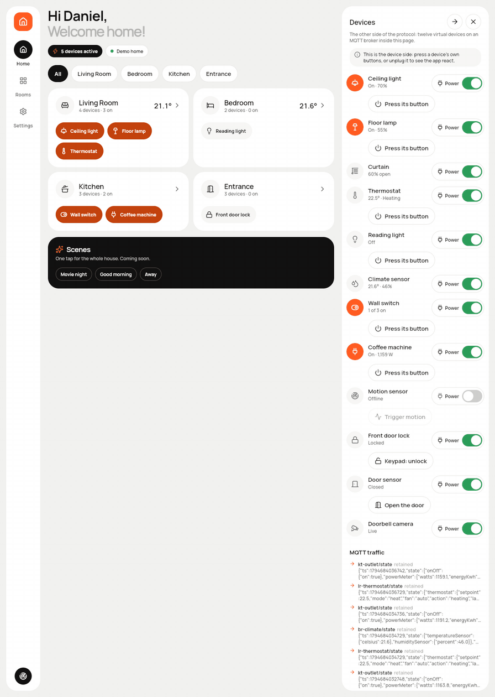
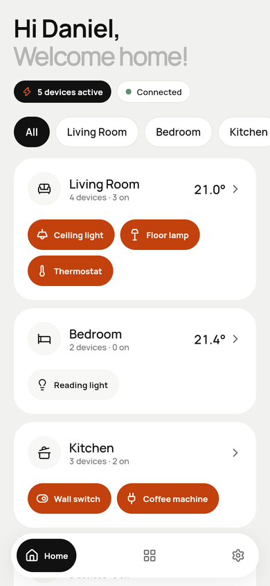
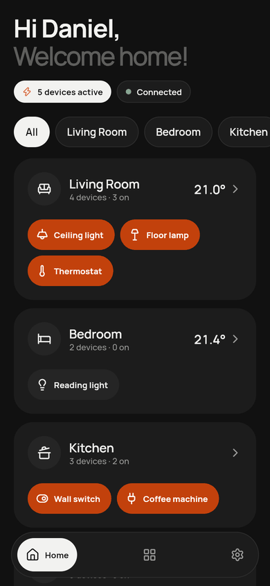
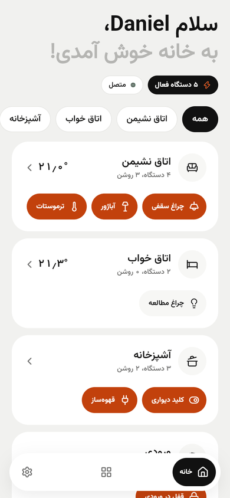
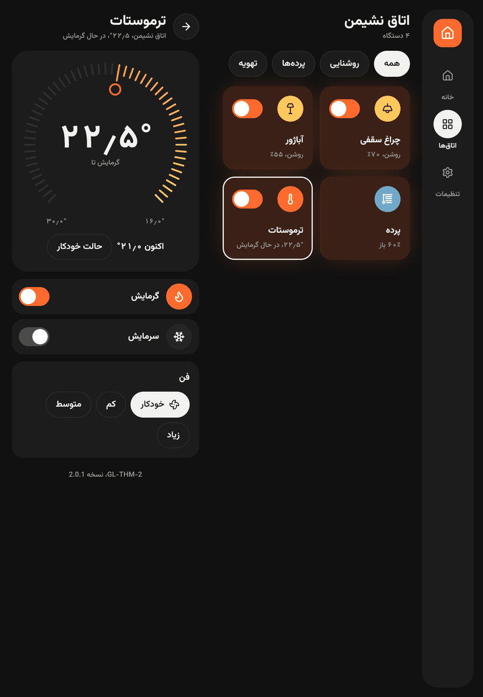

# Glowhaus

An open-source smart home demo app built with Flutter, on its own documented
MQTT protocol. It shows real-time device control with optimistic UI and
rollback, a capability-based device model, a device side that anyone can
implement from the spec, adaptive phone / tablet / desktop layouts, light and
dark themes, and English, Persian (RTL) and Turkish.



*Left, the app. Right, the devices panel: the other end of the protocol. A
tap in the app is a `set` the device acks and answers with retained
`state`; the device's own button is a `state` report with no command; a
command that is never acked is undone after five seconds.*

**Live:** [the app](https://dannymohajer.github.io/glowhaus/)
· [with the devices panel](https://dannymohajer.github.io/glowhaus/#/demo)
· [Widgetbook](https://dannymohajer.github.io/glowhaus/widgetbook/)

> Status: milestone 1 (foundation) and milestone 3 (real MQTT) are done.
> The scenes UI from milestone 2 is next. See the [roadmap](docs/roadmap.md).

## Run modes

| Mode | How | Broker | Devices | Works where |
|---|---|---|---|---|
| Demo | open the app | in memory, inside the page | the twelve virtual devices of the demo home, in the same page | every browser, every platform, offline |
| Demo with the devices panel | open [`#/demo`](https://dannymohajer.github.io/glowhaus/#/demo), or the radar button on the rail | as above | as above, with their own buttons, plugs and the MQTT traffic | as above; beside the app on wide windows, a sheet on phones |
| Two tabs | the panel's arrow button opens `#/devices` | in memory, in the app tab | in the second tab, as MQTT clients relayed over a `BroadcastChannel` | two tabs of the same browser (see [known limits](#known-limits)) |
| Docker broker | Settings → Connection → My broker | Mosquitto 2 with TLS, WSS and per-identity ACLs ([`infra/`](infra/README.md)) | the [simulator](simulator/README.md) container, each device with its own login | web over `wss://…:8884/mqtt`, native over `mqtts://…:8883` |
| A phone on the LAN | [LAN mode](infra/README.md#lan-mode-a-real-phone-on-the-same-wi-fi) of the Docker broker | as above | as above | a real Android phone or iPhone on the same Wi-Fi |

In every mode the app runs the same code: `MqttTransport` over an
`MqttConnection`. The demo's broker is an in-memory one and its devices are
the same device engine the simulator runs, so every tap in the demo is a
real `set`, ack and retained `state`. Only the network is imitated
(Settings → Simulation adds latency, rejected commands and lost ones).

## Screenshots

| Dashboard | Dark | Persian (RTL) | Thermostat |
|---|---|---|---|
|  |  |  |  |

Wide windows show rooms, room and device side by side:




## Features

**App**

- Rooms, devices and a dashboard for a seeded demo home
- Lights (on/off, dimmer, RGB), multi-channel switches, curtains, thermostat,
  outlets with live power, door lock, sensors, a doorbell camera entry
- Optimistic control: pending state, rollback on rejection or timeout, and a
  quiet note when a timed-out command turns out to have been applied
- Connection settings: the demo, or a real broker (host, port, path, home,
  username, password kept in memory only, an extra CA certificate). The
  broker's last-known devices show until the password is entered again.
- Phone and tablet / desktop layouts from one set of routes
- Light / dark / system theme, runtime accent colour, reduced motion
- English, Persian (RTL), Turkish with live switching
- Design system package with a Widgetbook catalog

**Protocol and devices**

- [Glowhaus protocol v1, revision 1.1](docs/protocol.md): discovery with
  retained per-device `info`, retained `state` and `availability` with a
  last will, commands with exactly one ack, error codes and expiry
- `glowhaus_device`: the device side as a pure Dart engine that depends only
  on the protocol package, the proof that the document is enough to build
  a device
- The devices panel: each device's own button and plug, and every MQTT
  message the devices send and receive
- Two-tab mode: the devices move to a second tab with their state and keep
  talking MQTT to the app's broker; they come back when the tab closes,
  online even if it vanished without a goodbye

**Infrastructure**

- docker compose: Mosquitto 2 (TLS 8883, WSS 8884, plain 1883 on loopback
  only), the simulator image with a watchdog and healthcheck, a MediaMTX
  RTSP test camera
- One identity per client and an ACL per identity: a device may publish only
  its own topics; CI proves it against the real broker over plain MQTT and
  TLS
- mkcert certificates, an opt-in LAN mode for a real phone, and a CA that
  the app trusts for the broker connection only, never process-wide

Coming:

- Scenes UI (milestone 2)
- Scenarios, automations, timers (milestone 4)
- Multiple homes, users and roles, add-device wizard (milestone 5)
- Offline / local control (milestone 6)
- Cameras: ONVIF, RTSP live view, PTZ (milestone 7)
- Optional: the demo over the internet through a hosted broker

## Quick start

Requires Flutter 3.47 or newer.

```bash
dart pub get
```

```bash
cd apps/glowhaus && flutter run -d chrome
```

That is the demo. Add `#/demo` to the address for the devices panel.

### With the Docker broker

On a Mac with Docker Desktop, mkcert and the mosquitto tools
(`brew install mkcert mosquitto`):

```bash
infra/scripts/make-users.sh
```

```bash
infra/scripts/make-certs.sh
```

```bash
docker compose -f infra/docker-compose.yml up --build --wait
```

The first script writes a random password for every identity to the
git-ignored `infra/secrets/credentials`; the second makes a certificate for
`localhost` with a CA that exists only on this machine and asks once for
your password to trust it. `--wait` returns when the simulator's devices
are connected.

Then in the app: Settings → Connection → My broker. The defaults (host
`localhost`, home `demo-home`, user `demo-home.app`) match the stack; the
password is the `demo-home.app` line of `infra/secrets/credentials`. The
web app connects over `wss://localhost:8884/mqtt`, a native macOS build over
`mqtts://localhost:8883`. Details, the ACLs, LAN mode and the iOS / Android
caveats: [infra/README.md](infra/README.md).

## Known limits

- **Two-tab mode is same-browser only.** A `BroadcastChannel` reaches tabs
  of the same origin in the same browser profile, nothing else: not another
  browser, not a private window, not another device. Across devices you
  need a real broker (the Docker stack today, a hosted one later). One tab
  runs the devices at a time (a Web Lock decides); another devices tab
  offers to take over.
- **The Wasm build cannot load code lazily.** The broker form and the
  `mqtt_client` adapter are deferred imports, so the JS build fetches them
  (53 KB gzip) only when someone opens the broker settings. Flutter 3.47
  ships Wasm as a single module, so on Chrome and Edge they are part of the
  first download anyway (`mqtt_client` itself is about 20 KB of that).
- **Development certificates.** The mkcert CA is trusted by the Mac it was
  made on. A phone has to trust it by hand, and Android's Dart TLS ignores
  user-installed CAs, so the native Android app takes the CA in its
  Connection settings. The iOS simulator and Android emulator use plain MQTT
  on the host's loopback instead.
- **The password is never stored.** After a restart in broker mode the app
  shows the last-known devices until it is typed again.
- **No camera playback yet.** The doorbell announces the test camera's RTSP
  URL; playing it is milestone 7.

## Repository layout

```
apps/glowhaus/            Flutter app (web, android, macos, ios)
packages/
  glowhaus_domain/        pure Dart: models, capabilities, protocol, topic codec
  glowhaus_mqtt/          MqttConnection, mqtt_client adapter, in-memory broker,
                          traffic log, the BroadcastChannel bridge
  glowhaus_device/        device engine: the protocol's device side, demo home
  glowhaus_transport/     Transport interface, MqttTransport, SimulatedTransport,
                          the two-tab demo host and guest
  glowhaus_ui/            design system: tokens, themes, components
widgetbook/               Widgetbook catalog of the design system
simulator/                device simulator CLI: the demo home on a real broker
infra/                    docker compose: Mosquitto (TLS, WSS, per-identity ACLs),
                          simulator image, MediaMTX test camera
docs/                     architecture, protocol, roadmap
tool/                     web build, size report, screenshots, the README GIF
```

## Development

Workspace scripts (format, analyze, test, codegen) run through melos:

```bash
dart run melos run analyze
```

```bash
dart run melos run test
```

Web build (app + Widgetbook in `build/site`, with a size report):

```bash
tool/build_web.sh
```

Screenshots and the README animation from a served build (headless Chrome;
the animation also needs ffmpeg):

```bash
python3 -m http.server 8100 --directory build/site
```

```bash
node tool/screenshots.mjs
```

```bash
node tool/record_demo.mjs
```

### Embedding

The web build is made to be embedded, for example in a portfolio page:

```html
<iframe src="https://dannymohajer.github.io/glowhaus/#/demo" title="Glowhaus demo"
        style="width: 1280px; height: 800px; border: 0; border-radius: 28px"
        loading="lazy"></iframe>
```

Use the plain address and a phone-sized frame (390 × 844) for the app alone.
It uses hash URLs, so reloads inside the frame never 404, and it loads
nothing from third-party hosts. Each build lives under its own `b/<id>/`
path and a tiny loader asks `build.json` (never cached) which one is
current, so a returning visitor gets a new deploy on the next load even
though GitHub Pages caches every file for ten minutes. A first visit downloads about 2.6 MB gzip
on Chrome and Edge (Wasm), 3.0 MB on the JS fallback; see the
[web build budget](docs/architecture.md#web-build-budget).

## CI

[`.github/workflows/ci.yml`](.github/workflows/ci.yml): format, analyze (zero
infos), a check that regenerating code and translations changes nothing, all
tests with goldens on macOS, a `broker` job that runs Mosquitto and the
simulator image and tests the ACLs and `MqttTransport` against them over
plain MQTT and TLS, the web build with its size table in the job summary,
and a GitHub Pages deploy from `main`.

## Documentation

- [Architecture](docs/architecture.md): packages, data flow, the
  `Transport` seam, the demo's device side, the web build budget, testing
- [Protocol](docs/protocol.md): topics, payloads, discovery, commands and
  acks, every capability, a device checklist, security
- [Infra](infra/README.md): the broker, its ACLs, TLS / WSS, LAN mode,
  the watchdog
- [Simulator](simulator/README.md): the device simulator CLI
- [Roadmap](docs/roadmap.md)

## License

[MIT](LICENSE)
