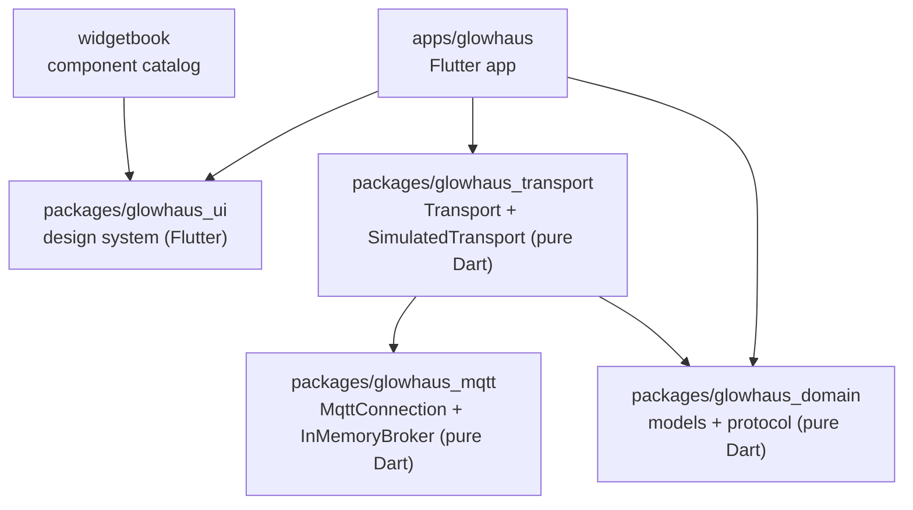
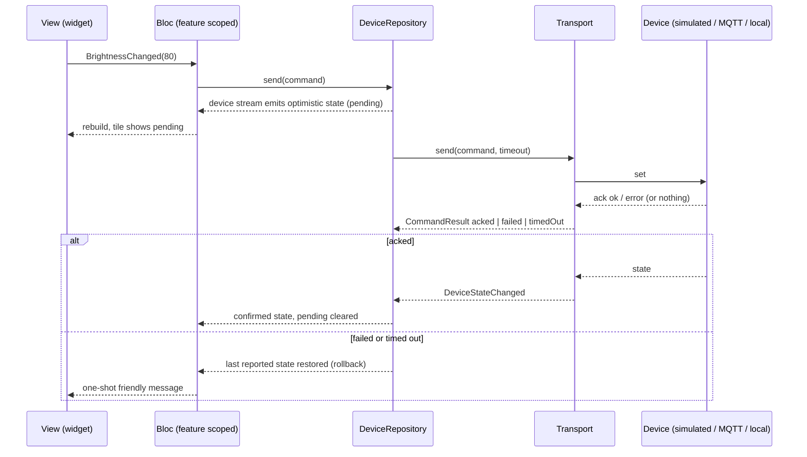

# Glowhaus architecture

Glowhaus is a smart home demo app. The architecture has one job: keep the
UI ignorant of *how* devices are reached, so the same screens work against an
in-memory simulation today, a real MQTT broker in milestone 3, and local
(offline) control in milestone 6.

## Packages



| Package | Depends on | Contains | Must never contain |
|---|---|---|---|
| `glowhaus_domain` | Dart only | `Home`, `Room`, `Device`, `Capability`, `Scene`, `User`/`Role`, command lifecycle, protocol payload models, the topic codec | Flutter imports, I/O, timers |
| `glowhaus_mqtt` | Dart only | `MqttConnection` interface, QoS and topic matching, `InMemoryBroker` | Glowhaus topics or payloads, Flutter imports |
| `glowhaus_transport` | `glowhaus_domain`, `glowhaus_mqtt`, `mqtt_client` | `Transport` interface, `MqttTransport` (+ the `mqtt_client` adapter), `SimulatedTransport`, seeded demo home | Flutter imports, UI concepts |
| `glowhaus_ui` | Flutter only | Tokens, themes, components | Domain models, blocs, strings that need translating |
| `apps/glowhaus` | all three | Features (bloc + view), repositories, routing, DI, l10n | Topic strings, raw JSON handling |
| `widgetbook` | `glowhaus_ui` | One use-case per component | App logic |

Two rules are worth calling out:

- **`glowhaus_ui` does not know the domain.** A `DeviceTile` takes a title, an
  icon, a `DeviceTileState` and callbacks, not a `Device`. The app maps domain
  objects to component inputs. This keeps the design system reusable and makes
  every component trivially renderable in Widgetbook and golden tests.
- **Only `glowhaus_domain` knows the wire format.** Topic strings are built and
  parsed in exactly one place (`TopicCodec`). Payload JSON is (de)serialized by
  the protocol models. A transport moves bytes; it does not invent formats.

## Data flow



Layers, top to bottom:

1. **View**: widgets from `glowhaus_ui` plus feature layout. Dispatches
   events, renders state. No business logic.
2. **Bloc**: one per feature, created by the route that needs it and disposed
   with it. A bloc receives ids (`roomId`, `deviceId`) and repositories; it is
   never handed to another screen. Two screens showing the same device each
   subscribe to the repository, which is the single source of truth.
3. **Repository**: `HomeRepository` (homes, rooms, scenes) and
   `DeviceRepository` (devices, commands). `DeviceRepository` folds transport
   events into a device map and owns the **optimistic overlay**: reported state
   plus the patches of commands still pending. Because the overlay lives here,
   the dashboard card, the room tile and the detail screen all show the same
   pending state and roll back together.
   An overlay entry is removed when a reported state **matches** the command's
   values (not when the ack arrives), or when the command fails or times out.
   A curtain therefore shows its new target immediately while the reported
   `position` catches up.
4. **Transport**: the seam. See below.

App-wide state is limited to what is truly app-wide: `SettingsCubit` (theme
mode, accent, locale, reduce motion, simulation knobs) and `ConnectionCubit`
(transport status for the `ConnectionBadge`).

## The Transport seam

```dart
abstract interface class Transport {
  /// disconnected, connecting, connected, reconnecting
  TransportStatus get currentStatus;
  Stream<TransportStatus> get status;

  /// DeviceAnnounced | DeviceStateChanged | DeviceAvailabilityChanged | DeviceRemoved
  Stream<DeviceEvent> get events;

  Future<void> connect();
  Future<void> disconnect();

  /// Completes with acked, failed(error), timedOut or unreachable (no
  /// broker connection). Never throws for device-level failures.
  Future<CommandResult> send(DeviceCommand command, {Duration timeout});

  Future<void> dispose();
}
```

The interface speaks domain objects, not MQTT. That is what lets the later
transports slot in without UI changes:

| Transport | Milestone | How it fulfils the interface |
|---|---|---|
| `SimulatedTransport` | 1 | In-memory devices, configurable latency / failure rate / timeout rate |
| `MqttTransport` | 3 | `TopicCodec` and the protocol models over an `MqttConnection`: the `mqtt_client` adapter (TCP + TLS on native, WSS on web) or the `InMemoryBroker`. Backoff reconnect; pending commands become `unreachable` when the link drops, devices keep their last known state |
| `LocalTransport` | 6 | UDP discovery + local WebSocket, same payload models |

Which transport is active is a DI decision (`get_it` + `injectable`
environments), invisible above the repository.

## Why capability-based devices

There is one `Device` model. A device has a `type` (light, switch, curtain,
thermostat, outlet, lock, sensor, camera) and a list of **capabilities**
(`onOff`, `brightness`, `color`, `colorTemperature`, `position`, `thermostat`,
`powerMeter`, `lock`, `temperatureSensor`, `humiditySensor`, `motionSensor`,
`contactSensor`, `camera`).

- `type` is a **presentation hint** only: which icon, which filter chip.
- **Capabilities decide behaviour.** The detail screen is composed from
  capability sections: a device with `onOff` gets a toggle, with `brightness` a
  slider, with `powerMeter` a live watts readout. A dimmer and an RGB lamp are
  both `light`; they differ only in capabilities. An outlet that later gains a
  power meter needs no new screen and no new model.
- A capability instance has an `id` and a `kind`. Usually they are equal. A
  three-gang wall switch has three `onOff` capabilities with ids `ch1`..`ch3`,
  so multi-channel devices need no special casing either.
- Unknown capability kinds are preserved and ignored, so a newer device does
  not break an older app.

The alternative, a class per device type with `if (type == ...)` lists
scattered through UI and logic, is exactly what this design avoids: every new
device type would touch every screen.

## Navigation and adaptive layout

One navigation system: `go_router`. The URL is the state.

| Route | Phone | Wide (rail + panes) |
|---|---|---|
| `/welcome` | full screen | full screen |
| `/home` | dashboard | dashboard |
| `/rooms` | rooms list | rooms list, hint |
| `/rooms/:roomId` | room screen | rooms list, room |
| `/rooms/:roomId/devices/:deviceId` | device detail | rooms list, room, device detail |
| `/settings` | settings | settings |

`AdaptiveScaffold` picks bottom navigation below 600 dp and a side rail above
it. The room routes all render the same `RoomsPanes` widget: one pane below
600 dp, two from 600 dp, three from 1000 dp. Panes are driven
by the same route parameters, so deep links, browser back and window resizing
behave identically on every form factor.

## Cross-cutting

- **DI**: `get_it` + `injectable`. Constructors take their dependencies; no
  static singletons or "manager" classes.
- **Models**: `freezed` + `json_serializable`, immutable, value-equal.
- **Localization**: `gen-l10n`, ARB files for `en`, `fa`, `tr`; live switching
  through `SettingsCubit`. Components take already-localized strings.
- **Theming**: `GlowhausColors` and friends are `ThemeExtension`s. The accent
  is a parameter of theme construction, so changing it at runtime is a rebuild
  with a new seed, not a global mutation.
- **Motion**: durations and curves come from tokens; "reduce motion" (system
  setting or in-app toggle) collapses them.

## Web build budget

The web build is embedded in a portfolio page, so size is a feature.
`tool/build_web.sh` builds the app and Widgetbook into one static site, and
`tool/web_size_report.sh` prints what a first visit downloads (CI writes the
table into the job summary, so a regression shows up in review).

**Renderer: Wasm (skwasm) with JS + CanvasKit fallback** (`--wasm`). The HTML
renderer no longer exists, so the choice is between CanvasKit (JS) and skwasm
(Wasm). Measured at the end of milestone 1 (gzip, as GitHub Pages serves it):

| First visit | Gzip |
|---|---:|
| Wasm + skwasm (Chrome, Edge) | ~2.5 MB |
| Wasm + skwasm_heavy (other WasmGC browsers) | ~3.3 MB |
| JS + CanvasKit, Chromium build (`--wasm` not used) | ~2.9 MB |
| JS + CanvasKit, full build (fallback for older browsers) | ~3.8 MB |

skwasm is the smallest path on the browsers most visitors use and it starts
faster; browsers without WasmGC fall back to JS automatically. It runs
single-threaded because GitHub Pages cannot send cross-origin isolation
headers, which is fine for this UI.

Other decisions:

- **No third-party downloads** (`--no-web-resources-cdn`): CanvasKit, skwasm
  and the engine's Roboto fallback font are served from the same site, not
  from Google's CDN. Browsers partition caches per site, so the CDN would not
  have been warm anyway.
- **Fonts**: one variable file per family, subset to the scripts we ship
  (`packages/glowhaus_ui/tool/subset_fonts.sh`): Manrope 87 KB (was 161 KB),
  Vazirmatn 169 KB (was 236 KB). Vazirmatn is loaded only when Persian is
  selected. Icons are one vendored Lucide font, tree-shaken to ~23 KB.
- **NOTICES** (1.4 MB raw, ~110 KB gzip) is only fetched if a license page is
  opened, which the app does not do at startup. It is left intact; trimming
  it would mean dropping license texts we are required to ship.
- `MaterialIcons`/`CupertinoIcons` "expected to find fonts" warning: the
  framework references those icons in widgets we never show, and the app sets
  `uses-material-design: false` to avoid shipping the font. Expected.
- Hash URLs (go_router's default on web) so a reload inside the iframe or on
  Pages never hits a 404.

## Names and translation

Names are data. A room, device or scene shows its `name` exactly as typed, in
every language. Seeded defaults (the demo home, a device's factory name) also
carry a `nameKey` (channels: `labelKey`); the app translates keys it knows and
otherwise shows the name. Renaming clears the key, so a user-entered name is
never translated, even if it happens to match a default.

## Testing strategy

| Level | What |
|---|---|
| Unit (`glowhaus_domain`) | Topic codec, payload round trips, capability logic |
| Unit (`glowhaus_transport`) | `SimulatedTransport`: latency, failure, timeout, state emission (fake clock + seeded RNG) |
| Unit (app) | Every bloc and repository, including optimistic rollback |
| Widget | `DeviceTile` states, `TickDial` drag, RTL dashboard |
| Golden | Key components, light and dark |
