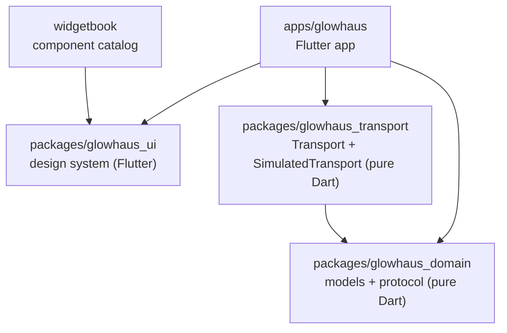
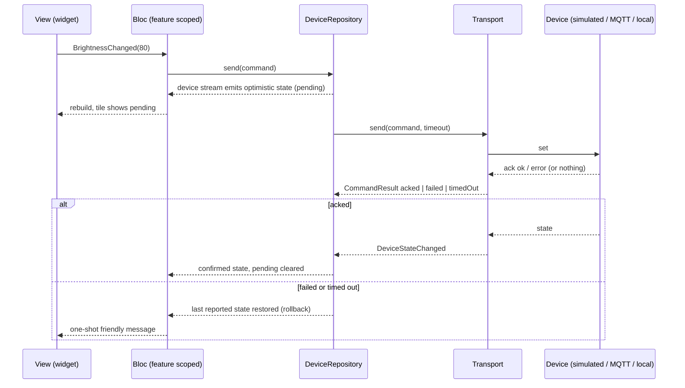

# Glowhaus architecture

Glowhaus is a smart home demo app. The architecture has one job: keep the
UI ignorant of *how* devices are reached, so the same screens work against an
in-memory simulation today, a real MQTT broker in milestone 3, and local
(offline) control in milestone 6.

## Packages



| Package | Depends on | Contains | Must never contain |
|---|---|---|---|
| `glowhaus_domain` | Dart only | `Home`, `Room`, `Device`, `Capability`, `Scene`, `User`/`Role`, command lifecycle, protocol payload models, the topic codec | Flutter imports, I/O, timers |
| `glowhaus_transport` | `glowhaus_domain` | `Transport` interface, `SimulatedTransport`, seeded demo home | Flutter imports, UI concepts |
| `glowhaus_ui` | Flutter only | Tokens, themes, components | Domain models, blocs, strings that need translating |
| `apps/glowhaus` | all three | Features (bloc + view), repositories, routing, DI, l10n | Topic strings, raw JSON handling |
| `widgetbook` | `glowhaus_ui` | One use-case per component | App logic |

Two rules are worth calling out:

- **`glowhaus_ui` does not know the domain.** A `DeviceTile` takes a title, an
  icon, a `DeviceTileState` and callbacks, not a `Device`. The app maps domain
  objects to component inputs. This keeps the design system reusable and makes
  every component trivially renderable in Widgetbook and golden tests.
- **Only `glowhaus_domain` knows the wire format.** Topic strings are built and
  parsed in exactly one place (`TopicCodec`). Payload JSON is (de)serialized by
  the protocol models. A transport moves bytes; it does not invent formats.

## Data flow



Layers, top to bottom:

1. **View**: widgets from `glowhaus_ui` plus feature layout. Dispatches
   events, renders state. No business logic.
2. **Bloc**: one per feature, created by the route that needs it and disposed
   with it. A bloc receives ids (`roomId`, `deviceId`) and repositories; it is
   never handed to another screen. Two screens showing the same device each
   subscribe to the repository, which is the single source of truth.
3. **Repository**: `HomeRepository` (homes, rooms, scenes) and
   `DeviceRepository` (devices, commands). `DeviceRepository` folds transport
   events into a device map and owns the **optimistic overlay**: reported state
   plus the patches of commands still pending. Because the overlay lives here,
   the dashboard card, the room tile and the detail screen all show the same
   pending state and roll back together.
   An overlay entry is removed when a reported state **matches** the command's
   values (not when the ack arrives), or when the command fails or times out.
   A curtain therefore shows its new target immediately while the reported
   `position` catches up.
4. **Transport**: the seam. See below.

App-wide state is limited to what is truly app-wide: `SettingsCubit` (theme
mode, accent, locale, reduce motion, simulation knobs) and `ConnectionCubit`
(transport status for the `ConnectionBadge`).

## The Transport seam

```dart
abstract interface class Transport {
  /// disconnected, connecting, connected, reconnecting
  Stream<TransportStatus> get status;

  /// DeviceAnnounced | DeviceStateChanged | DeviceAvailabilityChanged | DeviceRemoved
  Stream<DeviceEvent> get events;

  Future<void> connect();
  Future<void> disconnect();

  /// Completes with acked, failed(error) or timedOut. Never throws for
  /// device-level failures.
  Future<CommandResult> send(DeviceCommand command, {Duration timeout});
}
```

The interface speaks domain objects, not MQTT. That is what lets the later
transports slot in without UI changes:

| Transport | Milestone | How it fulfils the interface |
|---|---|---|
| `SimulatedTransport` | 1 | In-memory devices, configurable latency / failure rate / timeout rate |
| `MqttTransport` | 3 | Uses `TopicCodec` and the protocol models over TCP (native) or WSS (web) |
| `LocalTransport` | 6 | UDP discovery + local WebSocket, same payload models |

Which transport is active is a DI decision (`get_it` + `injectable`
environments), invisible above the repository.

## Why capability-based devices

There is one `Device` model. A device has a `type` (light, switch, curtain,
thermostat, outlet, lock, sensor, camera) and a list of **capabilities**
(`onOff`, `brightness`, `color`, `colorTemperature`, `position`, `thermostat`,
`powerMeter`, `lock`, `temperatureSensor`, `humiditySensor`, `motionSensor`,
`contactSensor`, `camera`).

- `type` is a **presentation hint** only: which icon, which filter chip.
- **Capabilities decide behaviour.** The detail screen is composed from
  capability sections: a device with `onOff` gets a toggle, with `brightness` a
  slider, with `powerMeter` a live watts readout. A dimmer and an RGB lamp are
  both `light`; they differ only in capabilities. An outlet that later gains a
  power meter needs no new screen and no new model.
- A capability instance has an `id` and a `kind`. Usually they are equal. A
  three-gang wall switch has three `onOff` capabilities with ids `ch1`..`ch3`,
  so multi-channel devices need no special casing either.
- Unknown capability kinds are preserved and ignored, so a newer device does
  not break an older app.

The alternative, a class per device type with `if (type == ...)` lists
scattered through UI and logic, is exactly what this design avoids: every new
device type would touch every screen.

## Navigation and adaptive layout

One navigation system: `go_router`. The URL is the state.

| Route | Phone | Wide (rail + panes) |
|---|---|---|
| `/welcome` | full screen | full screen |
| `/home` | dashboard | dashboard |
| `/rooms/:roomId` | room screen | rooms list, room |
| `/rooms/:roomId/devices/:deviceId` | device detail | rooms list, room, device detail |
| `/settings` | settings | settings |

`AdaptiveScaffold` picks bottom navigation below 600 dp and a side rail above
it; from 840 dp the room routes render as master-detail panes. Panes are driven
by the same route parameters, so deep links, browser back and window resizing
behave identically on every form factor.

## Cross-cutting

- **DI**: `get_it` + `injectable`. Constructors take their dependencies; no
  static singletons or "manager" classes.
- **Models**: `freezed` + `json_serializable`, immutable, value-equal.
- **Localization**: `gen-l10n`, ARB files for `en`, `fa`, `tr`; live switching
  through `SettingsCubit`. Components take already-localized strings.
- **Theming**: `GlowhausColors` and friends are `ThemeExtension`s. The accent
  is a parameter of theme construction, so changing it at runtime is a rebuild
  with a new seed, not a global mutation.
- **Motion**: durations and curves come from tokens; "reduce motion" (system
  setting or in-app toggle) collapses them.

## Web build budget

The web build is embedded in a portfolio page, so size is a feature:

- Fonts are bundled as variable fonts (one file per family instead of one per
  weight). Vazirmatn is loaded on demand the first time Persian is selected,
  not at startup.
- One icon package (Lucide), tree-shaken to the glyphs actually used.
- No runtime font or asset downloads from third parties.
- Renderer choice and measured sizes are recorded in the CI step that builds
  the web release, so a regression shows up in review.

## Testing strategy

| Level | What |
|---|---|
| Unit (`glowhaus_domain`) | Topic codec, payload round trips, capability logic |
| Unit (`glowhaus_transport`) | `SimulatedTransport`: latency, failure, timeout, state emission (fake clock + seeded RNG) |
| Unit (app) | Every bloc and repository, including optimistic rollback |
| Widget | `DeviceTile` states, `TickDial` drag, RTL dashboard |
| Golden | Key components, light and dark |
